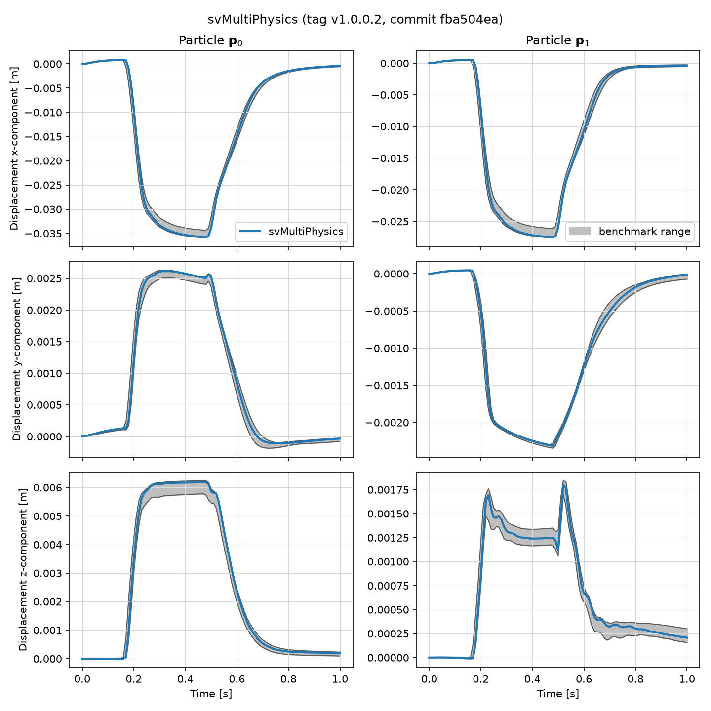

# Left-ventricle elastodynamics benchmark

The benchmark is one cardiac cycle of an idealized left ventricle as proposed in 
[Aróstica et al. (2025)](https://doi.org/10.1016/j.cma.2024.117485). The mesh is
quadratic tetrahedra with nodal fiber and sheet directions. Endocardial
pressure and active stress are prescribed as described in the paper.
The timestep is 1ms and the simulation runs for one cardiac cycle of 1s. 
Displacements are saved every 10 steps.

## Evaluation

Displacements are sampled at p0, `(0.025, 0.03, 0)` m, and p1, `(0, 0.03, 0)` m.
For each of ux, uy, and uz, the benchmark checks if a displacement is out of the 
envelope generated by the ten nonblinded step-1 groups in
`reference/` ([Zenodo](https://zenodo.org/records/14260459)). 

## Running the benchmark

Run `./allRun` from this directory. Python 3.12 or newer must provide the
packages in `requirements.txt` and svbenchmark 0.1.0 from commit `1cc0ab2`.

| Option | Description |
| --- | --- |
| `--solver PATH` | svMultiPhysics executable. Defaults to `SVMP_EXECUTABLE` or `svmultiphysics` on `PATH`. |
| `--ranks N` | Number of MPI ranks. Defaults to 1. |
| `--figures` | Generate the displacement figure after the solve. Off by default. |
| `-h`, `--help` | Show command-line help. |

## Runtime reference

Solver time measured with 8 MPI ranks: 0.84 hours elapsed, 6.8 core hours.
Sampling the saved displacements adds a few seconds.

## Results

Displacement of p0 and p1. The shaded band is the published envelope.

